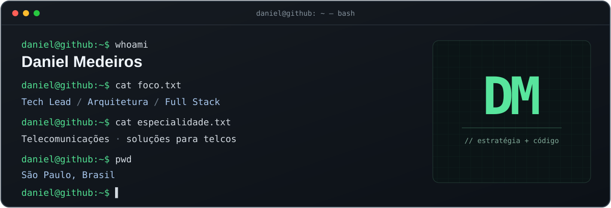

### `01. // sobre_mim()`

**Tecnologia desde 2002. Estratégia, arquitetura e código para tirar boas ideias do papel.**

Sou Tech Lead, arquiteto de software e desenvolvedor full stack. Conecto visão de negócio e execução técnica, acompanhando produtos digitais da arquitetura à entrega e evolução. Como fundador e CTO da **Devinhas**, atuei em telecomunicações, turismo, logística, mobilidade, varejo e fintechs.

### `02. // experiências_em_destaque()`

📡 **Telecomunicações** · Especialista em telcos, com experiência no desenvolvimento de soluções para o setor.

🏆 **Wanessa Camargo** · Desenvolvi o site da artista durante **7 anos**, em um trabalho premiado.

### `03. // tecnologias()`

**Backend**  

**Frontend**  

**Cloud & ferramentas**  

APIs REST · bancos relacionais e NoSQL

### `04. // além_do_código()`

Também participei de projetos premiados em hackathons, incluindo **Hackodonto / Odontoprev**, **AngelHack**, **Hackathon FIESP** e **IBM BlueHack**.

Vamos conversar sobre tecnologia e produtos digitais? [LinkedIn](https://linkedin.com/in/danielmmf) · [Portfólio](https://danielmmf.github.io/)
