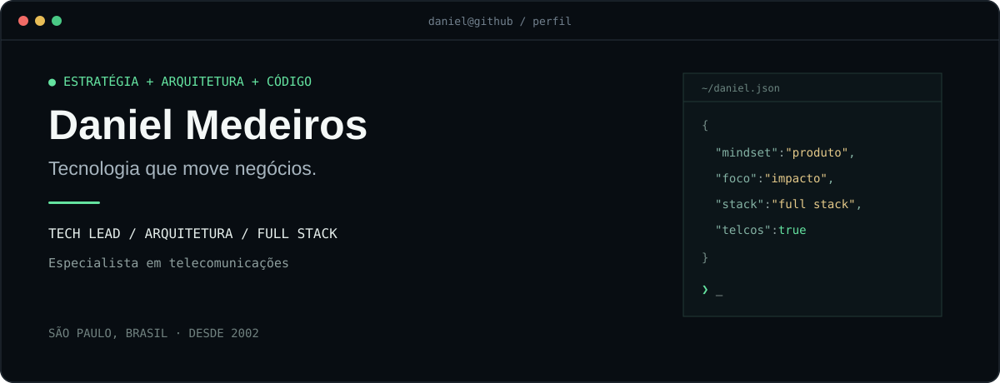

<div align="center">



<br>

[](https://linkedin.com/in/danielmmf)
[](https://danielmmf.github.io/)
[](mailto:danielmmf@gmail.com)


</div>

### `01. // sobre_mim()`

```javascript
const daniel = {
  nome: "Daniel Medeiros",
  atuacao: ["Tech Lead", "Arquitetura de Software", "Full Stack"],
  experiencia: "Tecnologia desde 2002",
  foco: "Transformar desafios de negócio em produtos digitais",
  localizacao: "São Paulo, Brasil"
};
```

Atuo com tecnologia desde 2002, conectando visão de negócio e execução técnica. Ao longo dessa trajetória, participei da criação e modernização de aplicações web, plataformas corporativas, sistemas distribuídos, e-commerces e produtos SaaS.

Como fundador e CTO da **Devinhas**, trabalhei com projetos em turismo, logística, mobilidade, varejo, telecomunicações e fintechs. Gosto de acompanhar o produto de ponta a ponta: do discovery e da arquitetura ao desenvolvimento, implantação e evolução contínua.

```diff
+ Liderança técnica e arquitetura alinhadas aos objetivos do negócio
+ Desenvolvimento de aplicações, APIs e integrações
+ Cloud, infraestrutura e evolução de sistemas
+ Colaboração para transformar ideias em soluções úteis
```

### `02. // tecnologias()`

**Backend**  


**Frontend**  


**Cloud & DevOps**  


**Integrações e dados:** APIs REST · bancos relacionais e NoSQL · Lumen

### `03. // alem_do_codigo()`

🏆 Participei de projetos premiados em hackathons, incluindo **Hackodonto / Odontoprev**, **AngelHack**, **Hackathon FIESP** e **IBM BlueHack**.

💬 Vamos conversar sobre arquitetura, desenvolvimento e produtos digitais? Me encontre no [LinkedIn](https://linkedin.com/in/danielmmf) ou conheça meu [portfólio](https://danielmmf.github.io/).
